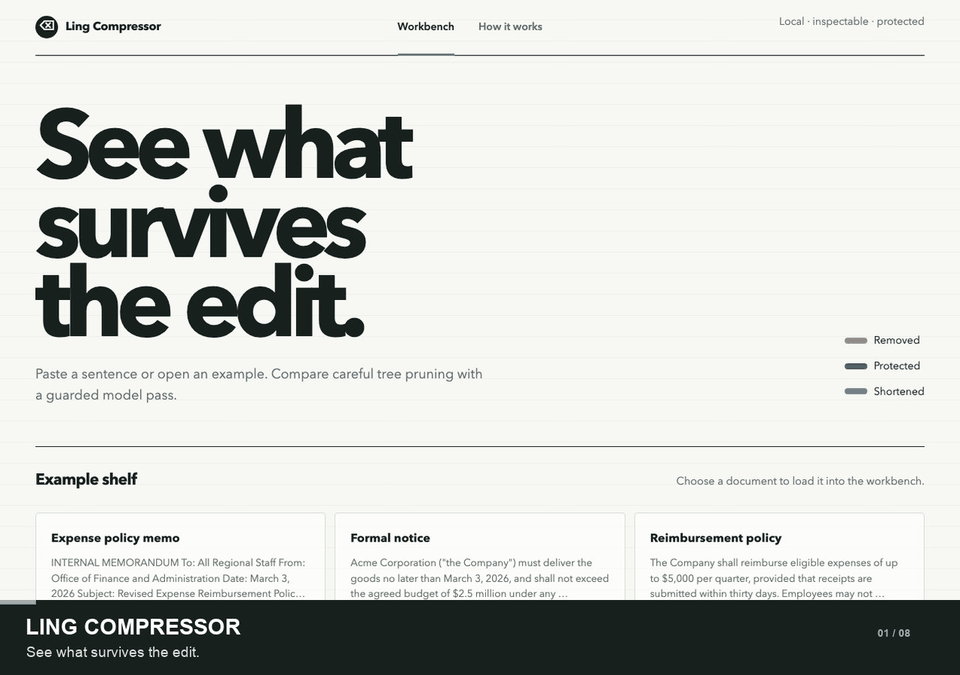

# promptcomp — auditable prompt compression

## TL;DR

`promptcomp` makes English prose shorter so it uses fewer tokens (the pieces of text
an AI model reads). It maps each sentence into a tree of connected words and
phrases, then prunes optional branches while keeping the main message. For example:

```text
The team approved the plan with great enthusiasm.

approved
├── the team                 (who)
├── the plan                 (what)
└── with great enthusiasm    (extra detail: prune this branch)

The team approved the plan.
```

With the default token counter, that example goes from 9 tokens to 6.
It removes whole branches rather than isolated words, so the sentence stays
readable. Rules protect important details such as numbers, names, negation, and
conditions; when pruning would risk those details, it leaves them in place.

A local Python tool for reducing the token cost of long English documents sent to
LLMs. It removes selected grammatical phrases and records every deletion, while
rules protect numbers, negation, obligations, conditions, named entities, and
defined terms. It also leaves code and other structured blocks untouched.

The use case is a research workflow that passes lengthy source documents to an
LLM and needs to inspect what was omitted. `promptcomp` is deterministic and
extractive: it does not generate a summary or rewrite the source. Its protection
rules reduce a specific class of omissions; they do not prove that every meaning
is preserved.

## Project at a glance

- **Input:** long-form English prose, potentially mixed with code, tables, URLs,
  paths, or other structured content.
- **Output:** compressed text, token counts, and an audit trail of deletions,
  substitutions, and protected spans.
- **Built with:** Python, spaCy dependency parsing, tiktoken, an offline
  evaluation harness, and a local browser workbench.
- **Current evidence:** on three bundled documents, the conservative compressor
  retained 1,259 of 1,433 input tokens (about 88%) with zero protected-content
  violations recorded by the harness. This small corpus does not establish
  downstream answer quality. See the [evaluation summary](eval/SUMMARY.md).

## How it works

```text
input
  → separate prose from code, tables, paths, and structured content
  → dependency-parse prose into complete grammatical subtrees
  → veto candidates containing or governed by protected language
  → rank the remaining candidates and delete the least informative
  → apply configured phrase shortening
  → recombine everything in its original order
```

Only complete, contiguous modifier subtrees can be deleted. Core arguments and
passthrough content are not candidates. Every result includes the deletions, vetoes,
protect-list version, and configuration hash that produced it.

The requested ratio is a target, not a promise. A protection-heavy document may
remain close to its original size because safety vetoes take precedence over the
token budget.

## Example compression

With `target_ratio=0.6` and `min_tokens=0`:

```text
Before (26 tokens)
The committee, after a long and unusually detailed discussion in the morning,
approved the annual budget in order to begin the project quickly.

After (17 tokens)
The committee, after a long and detailed discussion in the morning, approved the
budget.
```

The compressor removed `unusually`, `annual`, and
`in order to begin the project quickly`, saving 9 tokens (34.6%). The result's audit
trail records each deletion while the time reference remains protected.

## Video demo



The 37-second animated demo shows two prompts in the local workbench: one loses
an optional phrase (9 → 6 tokens), while the other keeps a deadline and an
exception as it shrinks (33 → 24 tokens). It also opens the audit trail and shows
the compression pipeline. [Download the full MP4 (2.5 MB)](https://raw.githubusercontent.com/phongtnguyen2006/ling-compressor/main/demo/ling-compressor-demo.mp4).

## Quick start

Requires Python 3.12. The package install includes spaCy; download its English
model separately:

```bash
python -m pip install -e ".[dev]"
python -m spacy download en_core_web_sm
```

Start the visual workbench:

```bash
python scripts/ui.py
```

Then open [http://localhost:8000](http://localhost:8000). The website provides:

- bundled examples with highlighted deletions and protected spans;
- a free-form sentence and document workbench;
- token counts, timing, and a complete audit trail;
- an engineering diagram of the compression and safety paths.

Choose **Guarded LLMLingua-2** or open the **Hybrid guardrail** sample to try the
experimental hybrid in the workbench. Install `.[llmlingua]` first; the first run
loads its model. The hybrid view reports protected-clause and fallback counts rather
than a word-level deletion audit.

The website permits short examples by disabling the library's normal 500-token size
gate for interactive requests.

## Python API

```python
from promptcomp import compress

result = compress(
    text,
    target_ratio=0.6,
    max_deletion_fraction=0.5,
)

print(result.compressed)
print(result.tokens_before, result.tokens_after)
print(result.deleted)  # what was removed, where, and why
print(result.vetoed)   # what was protected and by which rule
```

By default, inputs under 500 tokens are returned unchanged. Pass `min_tokens=0` when
you intentionally want to experiment with shorter text.

The terminal inspection tool exposes the same pipeline:

```bash
python scripts/inspect.py --file data/samples/memo1.txt --ratio 0.6
```

## Protected content

The hard-veto layer covers:

- numeric literals, money, percentages, quantities, and dates;
- negation and modal scope;
- obligations, conditions, exceptions, and quantifiers;
- people, organizations, places, laws, products, and other named entities;
- configured terms and terms extracted from definition patterns.

Over-protection is allowed; losing protected content is a test failure. The critical
invariants also cover deterministic output, passthrough integrity, contiguous subtree
deletion, and grammatical structure.

## Experimental LLMLingua hybrids

The protection rules can also guide a more aggressive compressor. Here is an
illustrative pass through the `SentinelHybridCompressor`:

```text
Original:       The team worked carefully, unless spending exceeds $5,000.
Protected:      unless spending exceeds $5,000
Sent to model:  The team worked carefully, KEEPCLAUSEA.
Model may trim: The team worked KEEPCLAUSEA.
Restored:       The team worked unless spending exceeds $5,000.
```

The conditional clause is hidden from LLMLingua-2, then restored exactly. The
hybrid also requires the main subject and verb to survive. If the model drops or
moves the marker, loses those anchors, or fails the protected-content check, the
sentence falls back to `promptcomp`'s conservative compression. A protected main
clause takes that conservative path directly; sentences without protected content
can go to LLMLingua-2. This is a guardrail for specific protected details, not a
guarantee that every nuance survives model compression.

Install the optional backend with:

```bash
python -m pip install -e ".[llmlingua]"
```

[`eval/hybrid.py`](eval/hybrid.py) contains two research prototypes:

- `HybridCompressor` sends protected sentences through the conservative compressor
  and clean sentences through LLMLingua-2.
- `SentinelHybridCompressor` masks isolatable protected clauses, forces their
  sentinels and main-clause anchors through LLMLingua-2, restores the original clauses
  byte-for-byte, and falls back conservatively when validation fails.

```python
from eval.hybrid import SentinelHybridCompressor

compressor = SentinelHybridCompressor()
result = compressor.compress(text, 0.5)
print(result.text)
print(compressor.stats)
```

These hybrids compress further on some prose, but they are not part of the public API.
Protected-token validation is not the same as proof of semantic equivalence; use them
only for evaluation until downstream answer retention is measured.

## Experimental lexical opportunity pilot

The separate `promptcomp.lexical` API proposes word and phrase substitutions for
human review. It records original character offsets, source dictionaries, rejection
reasons, and complete-text token counts. The default compressor above is unchanged.
Suggested text is **unreviewed**: the grammatical and protection checks do not
establish semantic equivalence.

Install the optional candidate-retrieval dependencies and explicitly provision the
tokenizer once (the pilot itself blocks missing-asset downloads):

```bash
python -m pip install -e ".[lexical,dev]"
python -c "import tiktoken; tiktoken.get_encoding('o200k_base')"
```

Run the curated-rule baseline on the authored integration examples:

```bash
python -m eval.lexical_pilot \
  --corpus data/lexical-demo/prompts.jsonl \
  --corpus-label "Authored integration examples; not a representative benchmark" \
  --out .cache/lexical/curated-demo
```

The output directory must be new or empty. It contains Markdown/JSON summaries,
frozen inputs and hashes, full candidate pools and occurrence audits, and blank
edit/prompt review forms with a separate attribution key. Overall savings include
unchanged inputs. Without `--wordnet`, B0 is explicitly labeled curated-only.

```python
from promptcomp.lexical import PilotProvider, suggest

result = suggest("They worked in order to finish.", PilotProvider())
print(result.suggested)
print(result.review_status)  # pending
print(result.edits)
```

Locally supplied GloVe/word2vec text enables `b1` (the same baseline candidates
ranked by cosine), `b2` (an explicit baseline/neighbor slot allocation), and
`b2_union` (a wider diagnostic with extra work reported separately). Optional
WordNet data must also be provisioned explicitly. The bundled synthetic vectors
exercise these code paths; they are not pretrained embeddings or quality evidence.

Use `python -m eval.lexical_review` to validate annotated copies against a frozen
pilot run and report completed versus pending reviews. It keeps candidate ratings
separate from complete-output ratings. The [usage guide](docs/semantic-token-compression/usage.md)
includes commands and the initial review rubric.

See the [documentation index](docs/semantic-token-compression/README.md) and
[implementation record](docs/semantic-token-compression/implementation.md) for
stable requirements, decisions, verification evidence, and the Obsidian navigation
path. The local vault exposes the canonical Markdown through its `Ling Compressor/docs/semantic-token-compression`
folder.

### Semantic substitution in the Ling Compressor workbench

The semantic substitution experiment is a third path in the same local workbench
as tree pruning and guarded LLMLingua-2. Install the lexical dependencies and
local parser/tokenizer assets, then open the workbench:

```bash
python -m pip install -e '.[lexical,dev]'
python -m spacy download en_core_web_sm
python -c "import tiktoken; tiktoken.get_encoding('o200k_base')"
python scripts/ui.py
```

Open [http://localhost:8000](http://localhost:8000), select **Semantic
substitution**, then choose B0 (curated baseline), B1 (vector ranking), or B2
(additional vector neighbors). The bundled examples and tiny vectors are
**synthetic software fixtures**. For a real embedding experiment, obtain a
local GloVe text file, provide its path, and record its source. The workbench
shows complete-text token counts, occurrence edits, rejected candidates, and
an optional cost estimate. Cosine similarity and grammar checks cannot certify
that an edit preserves intent.

To generate a reproducible pilot and review its results, follow the
[pilot usage guide](docs/semantic-token-compression/usage.md) and the
[project board and mentor timeline](docs/semantic-token-compression/project-board.md).
The benchmark reporter reads a frozen pilot run and can optionally compute a
local sentence embedding similarity proxy. A [paired IFEval diagnostic](docs/semantic-token-compression/ifeval-paired-study-2026-11-25.md)
now scores local-model responses against the original instruction constraints
and records complete model-input tokens. Human review and representative
production-model accuracy remain separate measurements.

The opt-in **Tree + semantic** workbench mode applies audited tree pruning,
then lexical proposals to the pruned text. It displays both stages and their
token savings; the combined output remains unreviewed. See the [combined mode
guide](docs/semantic-token-compression/usage.md#combined-tree-pruning-and-semantic-proposals).

## Evaluation and tests

Run the complete suite:

```bash
python -m pytest -q
```

Run the offline document × compressor × ratio grid:

```bash
python eval/run.py \
  --corpus data/samples \
  --out eval/results \
  --ratios 0.3,0.5,0.7
```

The grid compares uncompressed text, naive stopword removal, `promptcomp`, and
LLMLingua-2 when installed. `protected_violation_count` must remain zero for the
conservative compressor. Generated reports in `eval/results/` are ignored by Git;
the tracked [evaluation summary](eval/SUMMARY.md) gives reproducible results for
the bundled corpus. The corpus is deliberately small, so the results are
directional rather than production evidence.

Install `.[anthropic]` and set `ANTHROPIC_API_KEY` for model-graded accuracy. Use
`AnthropicCounter` for Claude cost decisions; the default tiktoken counter is only a
fast local estimate.

## Project map

```text
src/promptcomp/   compressor pipeline and packaged rule data
scripts/          inspection CLI, local web server, corpus helper
ui/               browser workbench
eval/             baselines, hybrid prototypes, metrics, reports
tests/            unit, property, invariant, and UI tests
data/samples/     small public-style evaluation corpus
```

See [COMPRESSOR_SPEC.md](COMPRESSOR_SPEC.md) for implementation details, guarantees,
known limitations, and the current evaluation summary.
