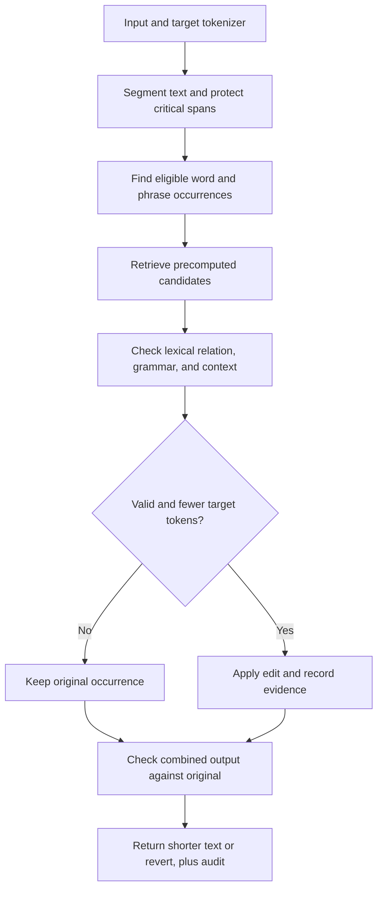

**Semantic Embedding-Based Token Compression & Vocabulary Substitution Tool — feasibility report**

Research date: September 24, 2026. Prepared from primary research papers, official documentation, and a read-only review of this repository. The proposed scope is an English-language, text-to-text compressor for ordinary LLM requests. The fall schedule assumes 14 project weeks; no semester start date was supplied.

**Recommendation: proceed as a bounded research extension to the existing compressor.** The engineering is feasible and the evaluation could make a strong semester project. Commercial value remains conditional on incremental token savings, retained task accuracy, and runtime cost. The broad mechanism has substantial prior art; a credible contribution would be a carefully measured, tokenizer-aware substitution system that can decline unsafe edits.

| Requested assessment | Judgment | Confidence and limit |
|---|---|---|
| Value-add | Strong educational/research value; plausible incremental product value | Additional savings over simple rules and the existing compressor remain unmeasured |
| Technical possibility | A working CPU-oriented prototype is realistic | General semantic equivalence cannot be guaranteed by cosine similarity, POS checks, or a sentence encoder |
| Prior art | Both embedding-driven lexical substitution and shorter-synonym compression already exist | This is a scoped literature review, not proof that every related implementation has been located |
| Implementation | Extend the current Python architecture, first as a separate substitution-only mode | Protect rewriting explicitly and evaluate before combining it with deletion |

**1. The value-add is strongest when a small, reliable saving applies repeatedly.** Suitable initial workloads include verbose explanatory prose, document passages used for question answering, and reusable prompt templates optimized once. For a deployment that already runs locally, a precomputed candidate dictionary could add little runtime work. Human-readable output and an explanation for each edit are practical advantages.

I would expect less opportunity in concise instructions, code, schemas, exact quotations, and texts dominated by numbers or specialist terminology. These are engineering expectations, not measured findings for this tool. Many ordinary words already consume few tokens, and preserving precise terminology rules out some of the most tempting replacements. Phrase shortening may offer more opportunity than isolated synonyms; the experiment should measure the two separately.

Three distinct outcomes matter:

- **Input savings:** fewer tokens sent to the selected model.
- **Context capacity:** room for more useful information within the same input limit.
- **Net efficiency:** less total spending or elapsed time after compression, validation, output generation, retries, and recovery.

The first outcome does not establish the third. A contextual validator can cost more than the tokens it removes. A small change can also alter the answer or increase output length. Use this accounting model:

`net saving per request = original total request cost − compressed total request cost − preprocessing cost − added expected recovery cost`

For a simplified uncached-input calculation:

`gross input saving = requests × original input tokens × reduction fraction × input price per million / 1,000,000`

For illustration only, one million requests containing 4,000 input tokens each, reduced by 5%, save 200 million input tokens. At an assumed $2 per million input tokens, that is **$400 gross savings**. Preprocessing at an assumed $0.0001 per request consumes $100, leaving $300 before other effects. These are hypothetical prices and savings, not a forecast or a current provider quote. If input accounts for only 25% of the original bill, a 5% input reduction lowers the total bill by only 1.25%, assuming everything else stays constant.

Caching changes the comparison. Stable prefixes can already receive cache benefits; changing them can reduce reuse. Optimize a reusable template once, version it, and then keep its compressed form stable. Compare actual cached and uncached usage, including any cache-write charges, rather than valuing every removed token at the uncached rate. The need for matching prefixes is documented in [OpenAI's prompt-caching guide](https://developers.openai.com/api/docs/guides/prompt-caching).

My product assessment is therefore **promising as an optional optimization layer, unproven as a standalone cost-saving product**. The decisive comparison is against the current compressor and a small curated dictionary. If embeddings cannot improve their savings–accuracy tradeoff, their added complexity has not earned its place.

**2. The mechanism is possible, but semantic validation is the difficult part.** The proposed system uses embeddings internally to find replacement text. The receiving LLM still processes ordinary text with its own tokenizer. This does not modify the model's vocabulary or replace a sentence with a GloVe vector inside a standard text API request.

Learned representations such as gist tokens belong to a different approach: they require a model trained to interpret the compressed representation. [Learning to Compress Prompts with Gist Tokens](https://arxiv.org/abs/2304.08467) illustrates that distinction. For this project, producing shorter readable text keeps the integration manageable.

The named embedding families serve different roles:

| Resource | Appropriate role | Limitation |
|---|---|---|
| GloVe | Static retrieval/ranking baseline for possible word replacements | One vector per vocabulary item does not select the intended sense; neighbors need not be synonyms |
| FastText | Alternative retrieval baseline, including rare and inflected words | Character n-grams are not the target LLM's BPE tokens; generating unseen-word vectors needs the model, not just a fixed exported vocabulary |
| Sentence-Transformers | Compare original and modified sentences or phrases | Similarity is a diagnostic, not a guarantee of equivalence; encoding an isolated word does not recover its sentence context |
| WordNet and curated phrase rules | Restrict candidates using lexical relations and known constructions | Word-sense ambiguity and contextual incompatibility still require checks |

These roles follow the [GloVe project](https://nlp.stanford.edu/projects/glove/), [FastText model documentation](https://fasttext.cc/docs/en/crawl-vectors.html), [Sentence-Transformers similarity documentation](https://sbert.net/docs/sentence_transformer/usage/semantic_textual_similarity.html), and [WordNet](https://wordnet.princeton.edu/).

The central failure cases are concrete:

| Failure | Why cosine/POS is insufficient | Proposed response |
|---|---|---|
| Related word mistaken for synonym | Two animals, organizations, or medical concepts can be close in vector space | Require lexical and contextual evidence; protect entities and terminology |
| Opposite meaning | Antonyms often occur in similar contexts and share POS | Exclude known antonyms and check context; do not rely on a higher cosine threshold |
| Wrong word sense | A single vector mixes meanings such as financial and river “bank” | Validate the particular occurrence; abstain on uncertain senses |
| Grammar or collocation damage | Agreement, verb argument structure, and combinations such as “strong tea” matter | Match morphology and syntax, then assess the edited sentence |
| Logical change | Modality, quantifiers, comparison, conditions, and negation control behavior | Freeze critical spans and their relevant scope, plus user-specified exact text |
| No token benefit | Fewer letters need not mean fewer subword tokens | Retokenize the changed text using the selected target tokenizer |
| Accumulated drift | Several individually plausible edits can interact | Limit edits initially; compare final output with the original and roll back failures |

These are established concerns. Distributional vectors can place antonyms near synonyms, as discussed in [Unraveling Antonym's Word Vectors](https://aclanthology.org/P19-1319/). An evaluation of substitution methods also found that commonly used semantic and grammatical filters admit invalid replacements: [Are Synonym Substitution Attacks Really Synonym Substitution Attacks?](https://aclanthology.org/2023.findings-acl.117/).

POS tagging is a useful filter, but both “increased” and “decreased” can satisfy it. Similarly, a high whole-sentence similarity score can conceal one consequential changed word. No universal threshold such as cosine ≥ 0.9 should be described as “90% meaning preserved.” Thresholds need calibration against judgments of acceptable substitutions.

Token counting must target the receiving model. A BERT/WordPiece tokenizer used by a validator is not automatically the right counter for a generation model. Count replacements with their whitespace, capitalization, inflection, and punctuation in context; independently counted word costs are only a preliminary filter. [tiktoken](https://github.com/openai/tiktoken) provides model-specific BPE encodings. For Claude evaluation, use the selected model's counting endpoint and reconcile against actual request usage; its documentation describes preflight counts as estimates. [Claude token-counting documentation](https://platform.claude.com/docs/en/build-with-claude/token-counting).

“Lightweight” requires an explicit memory budget. The classic 400,000-word, 300-dimensional GloVe vocabulary needs approximately **480 MB** for float32 values alone, calculated as 400,000 × 300 × 4 bytes. A pruned 50,000-word, 100-dimensional table needs **20 MB** before strings, metadata, and indexes. These are storage calculations, not measured process memory. Pretrained options and dimensions are listed by [Stanford](https://nlp.stanford.edu/projects/glove/).

Start with normalized vectors and exact search, or build candidate lists offline and use dictionary lookups at runtime. FAISS can support the offline search; its `IndexFlatIP` supports cosine search with normalized vectors. Approximate indexing is worth adding only if measured dictionary size and build time require it. A hosted vector database is unnecessary for this MVP. [FAISS index documentation](https://github.com/facebookresearch/faiss/wiki/Faiss-indexes).

**3. Substantial prior work exists, including close implementations.** The table distinguishes predecessors that validate parts of the idea from systems that directly compete with its token-saving objective.

| Work | Relationship to this proposal | What it does not establish |
|---|---|---|
| [Investigating Lexical Substitution Scoring for Subtitle Generation, 2006](https://aclanthology.org/W06-2907/) | Uses shorter synonyms and contextual scoring for text compression | Optimizes subtitle character length, not LLM tokens |
| [Simplifying Lexical Simplification: Do We Need Simplified Corpora?, 2015](https://aclanthology.org/P15-2011/) | LIGHT-LS retrieves GloVe cosine neighbors and combines contextual, frequency, language-model, and morphological signals | Optimizes readability; does not establish BPE savings |
| [BERT-based Lexical Substitution, 2019](https://aclanthology.org/P19-1328/) | Generates and assesses substitutions with contextual representations | Lexical benchmark performance is not proof of downstream prompt fidelity |
| [Selective Context, 2023](https://aclanthology.org/2023.emnlp-main.391/) | Removes less informative context to reduce LLM workload | Its deletion savings cannot be assigned to synonym replacement |
| [LLMLingua, 2023](https://aclanthology.org/2023.emnlp-main.825/) | Uses a smaller model and budgeted prompt pruning | Large compression ratios involve removing content; they are not a target justified for this mechanism |
| [LLMLingua-2, 2024](https://aclanthology.org/2024.findings-acl.57/) | Uses distilled data and an encoder to predict token retention | A strong comparison baseline with a different editing mechanism |
| [Lexical Prompt Compression for Large Language Models, 2026 preprint](https://arxiv.org/abs/2609.13154) | Combines WordNet synonym shortening, POS operations, entity protection, and other lexical transformations; author code includes Streamlit | Combined-pipeline results do not isolate synonym savings or establish task correctness |

The 2015 GloVe-based work is particularly instructive: its error analysis includes changing “warm” to “cool.” The basic retrieval-and-filtering pipeline therefore predates this proposal, along with its central semantic failure mode. [Glavaš and Štajner, 2015](https://aclanthology.org/P15-2011/).

The closest located direct implementation is the 2026 lexical prompt-compression project and its [author-linked experiment repository](https://github.com/shaminchokshi/Lexical-Prompt-Compressor---Research-Experiment-Code). The related [less-tokens package](https://pypi.org/project/less-tokens/) explicitly disables synonym shortening in its careful mode because replacements can be too narrow or incorrect. Its published release history predates this report. The fetched preprint's submission date and arXiv identifier are inconsistent, so this report uses the year only and does not assert an exact submission day.

For perspective, that preprint reports 40.3% mean token reduction for its most aggressive combined configuration, alongside output-similarity measurements. That figure includes deletion and other operations; it is not evidence that this proposal will save 40%, or that the resulting answers are correct. Those experiments were not independently reproduced here. [2026 preprint](https://arxiv.org/abs/2609.13154).

The defensible research contribution would be: **quantifying the savings, accuracy, and latency of tokenizer-aware lexical compression under contextual constraints.** Potential differentiators are occurrence-specific validation, calibrated abstention, model-specific counting, protected instructions, and public failure-case analysis. Embeddings, synonym shortening, and a Streamlit dashboard are individually established components.

**4. Implementation should build on this repository while keeping the new method independently measurable.** The current project, named `promptcomp` in its README, already performs dependency-subtree deletion and 15 fixed phrase shortenings. It has no embedding retrieval or contextual substitution engine. The following components are reusable:

| Existing component | How to use it |
|---|---|
| [Prose segmentation in pipeline.py](../../src/promptcomp/pipeline.py) (line 85 at research date) | Retain structured blocks byte-for-byte; identify eligible prose |
| [spaCy parsing](../../src/promptcomp/parse.py) (line 13 at research date) | Reuse POS, morphology, dependencies, entities, and offsets |
| [Protection logic](../../src/promptcomp/protect.py) (line 76 at research date) | Refactor protected-span collection for both deletion and rewriting |
| [TokenCounter abstraction](../../src/promptcomp/tokens.py) (line 10 at research date) | Share counting, caching, and target-model configuration |
| [Existing phrase dictionary](../../src/promptcomp/data/substitutions.yaml) (line 5 at research date) | Preserve as a simple baseline |
| [Result model](../../src/promptcomp/types.py) (line 63 at research date) | Extend with per-occurrence edits, scores, rejection reasons, and token deltas |
| [Evaluation harness](../../eval/harness.py) (line 25 at research date) | Add substitution-only variants, datasets, quality measures, and ablations |

Several integration details matter. Protection currently applies to deletion candidates, then fixed substitutions run afterward. The [replacement function](../../src/promptcomp/substitute.py) (line 35 at research date) accepts a text and dictionary without protected spans, contextual checks, or a token counter. Expanding that dictionary with vector neighbors would inherit these gaps. Its global replacements also cannot distinguish different senses of the same word.

The current deletion budget uses spaCy tokens rather than target BPE counts, although the complete output is counted afterward. The public API also skips inputs under 500 tokens by default; explicitly disable that gate for research on short prompts and AG News. See [pipeline.py](../../src/promptcomp/pipeline.py) (line 29 at research date). Surface-preservation metrics and a dependency-root check do not establish semantic or grammatical fidelity, and [gold-answer generation remains a stub](../../eval/tasks.py) (line 60 at research date). Downstream evaluation needs actual development work.

The proposed runtime flow is:

Implement it in the following order:

1. **Define a narrow contract and freeze baselines.** Support English prose, an explicit target tokenizer, and unchanged output when no acceptable saving exists. Keep code, schemas, names, numbers, logical operators, defined terms, and exact-match strings protected. Start by compressing explanatory content; allow callers to mark instruction and evidence spans as immutable. Preserve the original compressor as a benchmark.
2. **Measure the opportunity before building a large index.** On a small representative development set, enumerate candidates from curated rules and WordNet, then from GloVe. Measure actual token opportunities and manually inspect candidate validity. Determine whether many usable substitutions exist beyond current phrase rules.
3. **Build the offline lexicon.** Store source/candidate forms, lexical relations or senses, POS, embedding score, inflection metadata, and approximate costs for selected tokenizers. Record asset versions and licenses. Use a pruned GloVe vocabulary first; compare FastText as an ablation rather than making both mandatory.
4. **Add an occurrence-level planner.** Propose changes at exact spans, reject overlaps, preserve case and morphology, and keep a mapping to original offsets. Require positive in-context token savings. Use deterministic ordering and tie-breaking for reproducibility. Recompute context when accepted edits affect later decisions.
5. **Add contextual checks and abstention.** Evaluate the edited sentence with a lexical substitution or masked-language model; use sentence embeddings as an additional signal. Test an optional bidirectional entailment check on difficult cases, recognizing that it can also make errors. Start with strict thresholds and a small edit cap. Keep uncertain text unchanged.
6. **Calibrate risk-dependent thresholds.** Use labeled development examples to choose thresholds for word/phrase type and POS when there is enough data; otherwise share a conservative threshold. Evaluate precision versus coverage. Do not lower semantic requirements merely to hit a requested compression ratio. Ambiguous senses should lead to abstention.
7. **Validate the complete output.** Check protected content and relations, final token count, grammar, and aggregate drift against the original text. Multiple individually valid edits may interact. Return the original or revert edits when checks fail. An audit supports reconstruction and inspection but does not make the compressed text semantically lossless.
8. **Benchmark and expose the result.** Add the evaluation plan below, then build the requested Streamlit dashboard as a thin client of the library. Once substitution-only results are understood, compare both orders of combining it with deletion, including reparsing and protection checks between stages.

For a CPU-first design, separate a fast mode using offline candidate lists and conservative rules from an optional contextual mode. Measure whether the contextual model improves the tradeoff enough to justify its memory and latency. A pretrained encoder avoids training a model from scratch, but does not remove runtime computation.

The dashboard should show original/compressed text with per-occurrence diffs, target tokenizer, total token counts, individual accepted and rejected suggestions, processing time, and editable cost assumptions. Add an accuracy-versus-savings plot from completed benchmark runs. Keep similarity scores labeled as similarity scores. Offer reversible user acceptance of suggestions, and export the audit and benchmark configuration. The existing browser workbench can supply interaction ideas while Streamlit meets the proposed project deliverable.

**5. Evaluation should make task correctness the main quality criterion.** GloVe is a representation resource; AG News is a task dataset. They do not provide the same kind of input to the project. The current canonical [AG News page](https://huggingface.co/datasets/fancyzhx/ag_news) has 120,000 training and 7,600 test examples across four news categories. It is useful for classification experiments, but a wrong date or company can leave the category unchanged. Its card also lists the license as unknown and describes non-commercial research use in the dataset summary; record provenance and clarify reuse terms before distributing a product dataset.

Use a small suite of complementary tests:

| Evaluation material | Purpose | Important control |
|---|---|---|
| AG News | Topic accuracy, throughput, and savings distribution | Deduplicate or audit overlap; tune on a development split, not the official test split |
| Representative project prompts | Establish practical incremental value | Include short, already concise, and protected-heavy inputs; count unchanged inputs |
| [TSAR lexical simplification data](https://github.com/LaSTUS-TALN-UPF/TSAR-2022-Shared-Task) | Check candidate acceptability in context | A valid simplification may save no tokens; score both properties |
| [SQuAD-style passage QA](https://rajpurkar.github.io/SQuAD-explorer/) | Test retention of answer-bearing facts | Keep questions/gold answers fixed; adjudicate valid paraphrases that exact match penalizes |
| [IFEval](https://huggingface.co/datasets/google/IFEval) | Test instruction constraints with executable checks | Evaluate responses against the original instructions, including required literal strings |
| Authored edge cases | Test negation, modality, quantities, ambiguous senses, entities, and terminology | Include cases in which returning unchanged text is the correct outcome |

Start with approximately 200 development prompts and a manually reviewed substitution sample to find failure modes. Scale to at least 1,000 held-out prompt/task examples across the selected workloads if resources allow. These are proposed starting sizes, not a claim that they provide enough statistical power for a one-percentage-point accuracy margin. Determine final sample size from observed paired variability and the desired confidence interval.

Compare these variants on the same inputs:

- Uncompressed input.
- Existing `promptcomp` pipeline.
- Curated phrase rules plus WordNet, without embeddings.
- Raw embedding neighbors plus POS constraints, as an experimental ablation.
- Embedding retrieval plus contextual checks and abstention.
- LLMLingua-2; add the closest lexical compressor if it can be reproduced within the schedule.
- Combined deletion and substitution, after separately measuring both.

Separate word-only from phrase-only edits. Compare GloVe with FastText only after a working baseline exists. Compare lexical-only validation with the contextual version. These ablations answer whether vectors and neural checks add value, rather than allowing fixed phrase rules or deletion to receive credit for an embedding method.

Report the following measures:

| Measure | Definition or interpretation |
|---|---|
| Corpus token reduction | `1 − sum(tokens_after) / sum(tokens_before)` over all inputs |
| Distribution and coverage | Median/tails of per-input savings, fraction changed, and fraction abstained |
| Incremental hybrid saving | `1 − hybrid_tokens / existing_compressor_tokens`, with the denominator stated |
| Task quality | Classification accuracy, QA EM/F1 plus adjudication where needed, instruction pass rate |
| Human edit quality | Meaning preservation, grammaticality, and harmful-edit rate with reviewer disagreement recorded |
| Surface invariants | Exact preservation of protected spans and structured blocks; supplement with relation/scope checks |
| Semantic diagnostics | BERTScore and sentence cosine at edited-sentence and document level |
| Runtime efficiency | Warm/cold latency, p50/p95, throughput, peak memory, and offline build cost |
| End-to-end benefit | Input/output usage, cache behavior, total latency, retries, and net cost |

BERTScore is useful as a secondary metric, but research finds it less sensitive to small errors when texts remain lexically similar. That is exactly the setting created by a few substitutions. [A Fine-Grained Analysis of BERTScore](https://aclanthology.org/2021.wmt-1.59/). Human semantic validity and model behavior also need separate evaluation: semantically similar edits have changed earlier NLP classifiers' decisions in [TextFooler](https://arxiv.org/abs/1907.11932); that result motivates testing and does not quantify the effect on current LLMs.

Freeze thresholds before final testing. Use paired comparisons, confidence intervals, fixed model versions and decoding settings, and repeated generations where necessary to measure output variability. A similar answer can still be wrong, so score against gold answers or executable requirements, not solely against the uncompressed model's answer. An independent evaluation model or human review reduces circular reliance on the same embedding used to accept edits.

Compare methods at matched task quality and, where possible, matched token budgets. Plot the tradeoff between savings and quality. Increasing compression while silently changing a requirement is a regression even if the average semantic score stays high.

Suggested decision targets, to agree with the mentor before final testing:

| Decision | Proposed criterion — not a predicted result |
|---|---|
| Useful substitution layer | Aim for at least 5% corpus-weighted token reduction on an agreed eligible prose workload; also report all-workload savings |
| Useful extension | Show incremental savings beyond the existing compressor or simple rules at comparable quality |
| Task non-inferiority | Aim for no more than 1 percentage point loss on primary task accuracy; require the paired confidence interval to support the claim, otherwise call it inconclusive |
| Protected content | Zero violations in the held-out invariant suite; this is finite test evidence, not a universal guarantee |
| Runtime | Positive net benefit for the selected deployment after validation and recovery costs; meet a predeclared latency budget |
| Embedding necessity | If a smaller lexical baseline is as good at lower cost, prefer it and report that result |

These targets prevent an attractive demo from becoming the sole success criterion. Even a result showing that careful synonym substitution offers little useful headroom can be a valuable research outcome when the experiment is reproducible and the limitations are clear.

**6. A 14-week fall plan can deliver the research, prototype, and dashboard.** This assumes one student working part-time, access to a development machine, limited evaluation compute, and a mentor available at the three checkpoints. Contextual training, multilingual support, and production deployment are outside the core schedule.

| Week | Work and concrete output | Mentor involvement |
|---|---|---|
| 1 | Review closest literature; define workloads, protected content, target tokenizer, and research questions | Share a one-page scope brief |
| 2 | Freeze baseline variants, dataset splits, quality measures, and initial cost assumptions | **Check-in 1:** approve scope, novelty claim, and evaluation criteria |
| 3 | Build corpus/tokenization analysis; quantify opportunities in curated rules and WordNet | — |
| 4 | Build pruned GloVe index and candidate export; record assets and licenses | — |
| 5 | Implement substitution-only planning, occurrence spans, morphology, exact counts, and audit records | — |
| 6 | Add protected rewriting and contextual validation; run a manual failure analysis | — |
| 7 | Calibrate thresholds and abstention on development data; present a first savings–quality curve | **Check-in 2:** decide whether embeddings justify their cost and whether to narrow scope |
| 8 | Complete meaningful edge-case tests and integration with the existing harness | — |
| 9 | Run held-out classification, QA, and instruction checks; review harmful substitutions | — |
| 10 | Run ablations and cross-tokenizer checks; compare with LLMLingua-2 and lexical baseline | — |
| 11 | Measure latency, memory, caching effects, and net cost; evaluate hybrid ordering | — |
| 12 | Build Streamlit dashboard around completed measurements and per-edit inspection | **Check-in 3:** review results, limitations, and demonstration |
| 13 | Freeze versions/configuration; reproduce experiments and finish report, charts, and documentation | — |
| 14 | Deliver presentation, repository release package, dashboard demo, and implementation recommendation | Final presentation |

If the academic term is shorter, reduce secondary datasets and defer FastText comparison or hybrid ordering. Preserve held-out task evaluation and the three mentor discussions. If the week-7 evidence is weak, redirect the remaining work toward explaining the failure modes and comparing simpler lexical rules; do not compensate by relaxing meaning-preservation requirements without reporting the change.

**7. The project proposal should make the empirical question explicit.** A more precise working title is “Context-Aware, Tokenizer-Aware Lexical Compression for LLM Prompts.” The original name remains usable if “embedding-based” is clearly defined as candidate retrieval inside a text-to-text tool.

Suggested proposal wording:

> Develop an English-language toolkit that proposes lower-token word and phrase substitutions using lexical resources and pretrained embeddings. Accept edits only when contextual, grammatical, protected-content, and target-tokenizer checks pass. Measure whether this adds useful savings over fixed phrase rules and the existing linguistic compressor without materially reducing downstream task accuracy. Provide a Streamlit interface that exposes edits, rejected candidates, token savings, runtime, and explicit cost assumptions.

The final deliverables should be a reproducible candidate builder; an audited substitution library; a benchmark with frozen splits and ablations; a failure-case catalogue; a Streamlit dashboard; and a report stating where the method does and does not help.

This feasibility study did not train or download embedding models, run paid LLM evaluations, or reproduce published compression benchmarks. The local tokenizer package is installed, but the relevant encoding assets were absent from its offline cache, so no illustrative token-count results are presented as new measurements. The numeric savings thresholds above are research targets. The next implementation milestone is the small candidate-opportunity study in weeks 3–4, which will establish whether the proposed semantic layer has enough practical headroom to justify a larger build.

## Traceability

This document preserves the research and decisions recorded on **2026-09-24**. Its repository observations describe that date; implementation status is maintained separately. The 2026-10-06 edit adds metadata and portable navigation only. Source-file line numbers are historical references, not live anchors.

- [Documentation index](README.md)
- [Subsequent two-agent debate and plan](debate-plan.md)
- [Current implementation requirements, decisions, and evidence](implementation.md)
